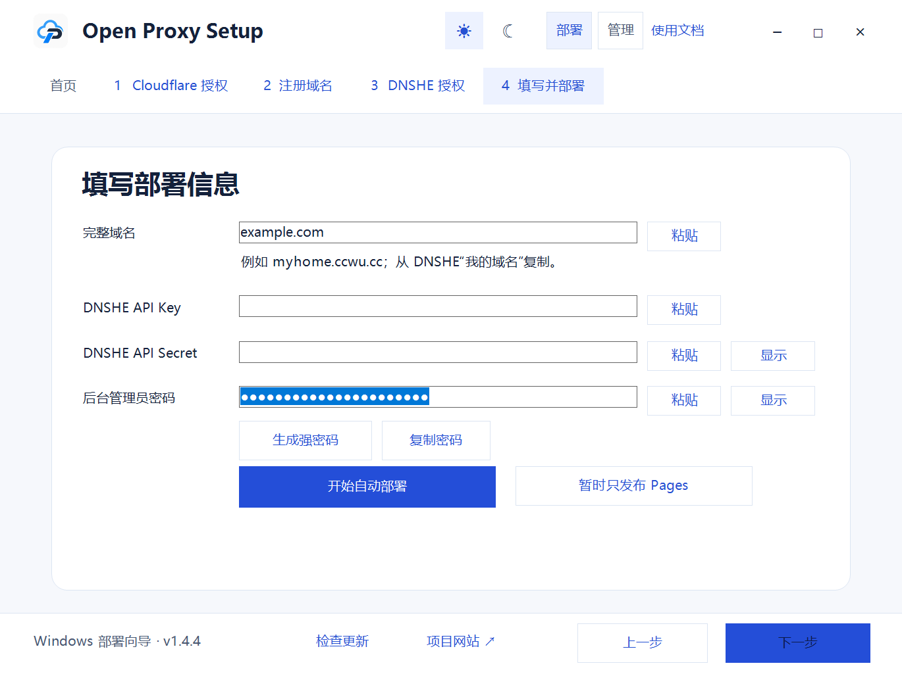
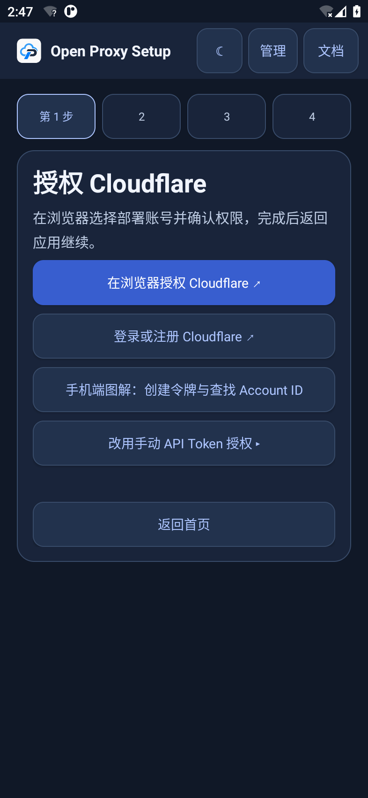

  
  <h1>Open Proxy Setup</h1>
  
<strong>Deploy and manage sites with your own Cloudflare account.</strong>

  
Windows & Android deployment wizards · Browser authorization · Multiple sites · Light & dark themes

  

    <a href="README.md">简体中文</a> ·
    <a href="README.en.md">English</a> ·
    <a href="README.ja.md">日本語</a> ·
    <a href="README.ko.md">한국어</a>
  

  

    <a href="https://openproxysetup.ccwu.cc/">Website</a> ·
    <a href="https://openproxysetup.ccwu.cc/docs/en.html">Documentation</a> ·
    <a href="CHANGELOG.md">Changelog</a> ·
    <a href="https://github.com/lomgzhijie/OpenProxySetup/issues/new/choose">Report an issue</a>
  

  

    
    
    
  

  

    
    
    
    
  

  

    <a href="https://github.com/lomgzhijie/OpenProxySetup/releases/download/v1.4.3/OpenProxySetup-windows-x64-setup.exe"><strong>⬇ Windows download</strong></a>
    &nbsp; · &nbsp;
    <a href="https://github.com/lomgzhijie/OpenProxySetup/releases/download/v1.4.3/OpenProxySetup-android-v0.3.11.apk"><strong>⬇ Android download</strong></a>
  

## Interface preview

Show Android interface

Development build previews below; download buttons link to the current public release.

## Quick start

OpenProxySetup provides deployment wizards for Windows and Android. Authorize your own Cloudflare account and set an administrator password. It uses the bundled [edgetunnel](https://github.com/cmliu/edgetunnel) source to create Cloudflare KV and Pages resources and displays a clickable site address. Open the site’s `/admin` page and enter the password to view nodes and subscription links in the upstream dashboard.

The project provides a deployment wizard. Each user deploys to their own Cloudflare account. Shared nodes, accounts, and hosting are outside the scope of the project.

The app checks for updates at startup and shows a dialog when a newer version is available. Choose Download update, Visit website, or Later. You can also check manually from the Android home screen or the Windows footer. Open the downloaded installer to update. This feature starts with Android v0.3.5 and Windows v1.4.1.

## Choose a platform

**We recommend using a Windows computer for your first deployment.** A larger screen and keyboard make it easier to enter domains, compare Cloudflare and DNSHE pages, copy credentials, and read error messages. You can also complete deployment and site management on Android when using a phone.

| Comparison | Windows | Android |
|---|---|---|
| System | Windows 10/11, x64 | Android 8.0 or later |
| Cloudflare authorization | Browser authorization through Wrangler | Browser OAuth or a manually entered API token |
| Initial setup | Keyboard and multiple windows help with first-time setup and troubleshooting | Touch input with switching between the app and browser |
| Deployment | Create KV and Pages, set the admin password, and bind a DNSHE domain | Create KV and Pages, set the admin password, and bind a DNSHE domain |
| Site management | Multiple sites, password verification, in-app dashboards, and light/dark mode | Multiple sites, password verification, in-app dashboards, and light/dark mode |
| Distribution | EXE installer, portable ZIP, and CMD edition | Installable APK |

Both platforms need network access to Cloudflare and DNSHE. The deployed site can be used with compatible clients. Choose the deployment platform that suits your workflow.

## Android APK

### Download and install

Requires **Android 8.0 or later**. Download the [Android v0.3.11 APK](https://github.com/lomgzhijie/OpenProxySetup/releases/download/v1.4.3/OpenProxySetup-android-v0.3.11.apk) and open it on your phone to install or update the app.

### First deployment

1. **Authorize Cloudflare.** Tap **Authorize Cloudflare in the browser**, sign in with your own account, and approve access. Back in the app, select the deployment account if prompted.
2. **Optional: use an API token.** Create a token with `Pages Write` and `Workers KV Storage Write` for your deployment account. Enter the token and the 32-character Account ID from Account Details, then verify and continue. Tap any step at the top to switch between steps.
3. **Prepare a DNSHE domain.** In step 2, open DNSHE and register a domain, or copy the full name of an existing domain, such as `myhome.ccwu.cc`.
4. **Create DNSHE API credentials.** On the DNSHE mobile site, expand Domain Management and find API Management in the navigation menu. Create an API key and copy both the API Key and API Secret.
5. **Start deployment.** In step 4, enter the full domain, API Key, and API Secret. Set an administrator password of at least 12 characters, then start deployment. To add a domain later, choose **暂时只发布 Pages** (Publish Pages only for now).
6. **Open the site dashboard.** After publication, you can sign in to the `pages.dev` dashboard using the password you just set. Allow about five minutes for custom domain validation. After one minute, you can tap **重新验证** (Recheck) to query the status. Once validation succeeds, open the dashboard at your custom domain. After the custom domain is verified, Android replaces the saved temporary `pages.dev` address for that deployment with your custom domain.

### Manage an existing site

Windows and Android have separate Deploy and Manage pages, with a switch in the top-right corner. The management list shows domain names and supports multiple saved sites, including adding, editing, and removing entries. Existing single-site records migrate automatically.

Choose Add site, enter its domain or HTTPS address and administrator password, and select Verify and save or Verify and open dashboard. The app verifies the supplied password independently of existing browser cookies and checks access to the protected dashboard before saving or opening. A failed verification cannot overwrite a previously saved password. Opening a saved site automatically verifies its stored password without asking you to type it again.

Site addresses and passwords are encrypted locally using Windows DPAPI for the current user or Android Keystore with AES-GCM. Remove one site or clear all local sites and login sessions. Removing a site leaves other entries intact. Cloudflare and DNSHE API credentials are excluded from this feature. The embedded dashboard retains its settings, node, and subscription features and follows the app's light and dark colors.

The Windows embedded dashboard requires Microsoft Edge WebView2 Runtime, normally included with Windows 11. If it is missing, install it from [Microsoft](https://developer.microsoft.com/microsoft-edge/webview2/) and reopen the app.

## Install and use on Windows

The home screen shows a legal notice and offers direct access to the admin dashboard. Successful deployments are added to the site list automatically. Existing sites can be added and verified manually. Switch to Manage at the top right to open a saved site or add and verify another site.

1. Download the [Windows x64 installer](https://github.com/lomgzhijie/OpenProxySetup/releases/download/v1.4.3/OpenProxySetup-windows-x64-setup.exe), double-click it, and select an installation location. Setup creates a `自建机场` folder and opens the wizard. To reopen the app, double-click `OpenProxySetup.exe` in that folder.
2. In step 1, select “开始 Cloudflare 授权” (Start Cloudflare authorization), sign up for or sign in to [Cloudflare](https://dash.cloudflare.com/sign-up) in your browser, and complete authorization. Return to the wizard and select “我已完成授权，继续” (I’ve authorized, continue). Once authorization is confirmed, obtain a domain from [DNSHE](https://my.dnshe.com/) in step 2 and create an API Key and API Secret under Domain Management → API Management in step 3. Enter your Cloudflare credentials on the Cloudflare website.
3. Enter the DNSHE domain, API Key, API Secret, and an administrator password of at least 12 characters. Start deployment. The app creates KV, Pages, and the secret, deploys the site, requests the custom domain binding in Pages, and uses the DNSHE API to add a CNAME pointing to `pages.dev`. Existing conflicting DNS records are preserved.
4. When deployment succeeds, open the displayed admin address and sign in with the password you set. Copy a node or subscription link from the dashboard and import it into a compatible client. Available formats depend on the upstream version used for deployment. Use the displayed `pages.dev` address while the custom domain is taking effect.

The deployment progress page shows Cloudflare authorization, KV creation, Pages publishing, and domain binding. Once Pages is published, you can open the temporary admin address. If domain binding fails, update the DNSHE credentials in the same app window and click Retry domain binding to reuse the existing Pages project and KV namespace.

The window stays responsive and shows elapsed time during deployment. Allow roughly 3–10 minutes, depending on the network and browser authorization. DNS and certificate activation for the custom domain may take several more minutes to a few hours.

The DNSHE API Key and Secret authorize adding the CNAME. The app uses them during the current session and keeps them out of project files. If existing DNS records conflict or DNSHE rejects the write, existing records are preserved. Use the `pages.dev` admin address while Cloudflare issues the certificate and DNS propagates. The Cloudflare Pages documentation allows a subdomain managed by external DNS to be bound via CNAME without creating a Cloudflare zone for it.

### System requirements

- Windows 10 or 11
- Network access to Cloudflare and DNSHE. Node.js, Wrangler, and the upstream node source are bundled. Git and a separate Node.js installation are unnecessary for running the app.

## Client compatibility

The platform and client list follows the [upstream edgetunnel documentation](https://github.com/cmliu/edgetunnel). Check that your client version supports your subscription format before importing.

| Platform | Clients |
| --- | --- |
| Windows | [v2rayN](https://github.com/2dust/v2rayN/releases), [Hiddify](https://github.com/hiddify/hiddify-app/releases), [FlClash](https://github.com/chen08209/FlClash/releases), [mihomo-party](https://github.com/mihomo-party-org/clash-party/releases), [Clash Verge Rev](https://github.com/clash-verge-rev/clash-verge-rev/releases), [Clashmi](https://github.com/KaringX/clashmi/releases), [FlyClash](https://github.com/GtxFury/FlyClash/releases), [Karing](https://github.com/KaringX/karing/releases), [Bettbox](https://github.com/appshubcc/Bettbox/releases) |
| Android | [v2rayNG](https://github.com/2dust/v2rayNG/releases), [ClashMetaForAndroid](https://github.com/MetaCubeX/ClashMetaForAndroid/releases/), [FlClash](https://github.com/chen08209/FlClash/releases), [Clashmi](https://github.com/KaringX/clashmi/releases), [Hiddify](https://github.com/hiddify/hiddify-app/releases), [NekoBox](https://github.com/MatsuriDayo/NekoBoxForAndroid/releases), [FlyClash](https://github.com/GtxFury/FlyClash/releases), [Karing](https://github.com/KaringX/karing/releases), [Bettbox](https://github.com/appshubcc/Bettbox/releases) |
| iOS | Surge, Shadowrocket, Stash, [Hiddify](https://github.com/hiddify/hiddify-app/releases), Loon, Egern, [Clashmi](https://github.com/KaringX/clashmi/releases), [Karing](https://github.com/KaringX/karing/releases), Quantumult X |
| macOS | [FlClash](https://github.com/chen08209/FlClash/releases), [mihomo-party](https://github.com/mihomo-party-org/clash-party/releases), [Clash Verge Rev](https://github.com/clash-verge-rev/clash-verge-rev/releases), Surge, [Clashmi](https://github.com/KaringX/clashmi/releases), [Karing](https://github.com/KaringX/karing/releases), [FlyClash](https://github.com/GtxFury/FlyClash/releases) |
| HarmonyOS | [ClashBox](https://github.com/xiaobaigroup/ClashBox/releases) |

## Portable ZIP

Extract the entire `OpenProxySetup-windows-x64-portable.zip` archive and double-click `OpenProxySetup.exe`. Keep the EXE, `runtime`, `vendor`, and scripts in the same directory. The app uses Windows’ .NET Framework and Windows PowerShell 5.1. If it fails to launch, run `启动应用.cmd` to see the error.

You can also download the [v1.4.3 CMD edition](https://github.com/lomgzhijie/OpenProxySetup/releases/download/v1.4.3/OpenProxySetup-windows-x64-cmd-v1.4.3.zip). Extract the entire ZIP and double-click `OpenProxySetup.cmd`.

## Packaging for maintainers

Run `npm ci --prefix runtime` in PowerShell to install the pinned Wrangler version, then place the Windows x64 `node.exe` and its `NODE-LICENSE` in `runtime`. Run `./打包发布.ps1` in Windows PowerShell 5.1 to compile the EXE and build the portable and CMD ZIP archives. Run `./构建应用.ps1` to compile the launcher separately, or `./构建安装程序.ps1` to turn the ZIP into an installer EXE. Launcher source is in `launcher/Launcher.cs`. These commands are for maintainers. To launch from source, run `./app.ps1`.

## How it works and scope

1. The package bundles a pinned upstream `_worker.js`, its GPL-2.0 license, and the upstream commit ID. The app uses the bundled files at runtime without running `git clone`.
2. The app uses Cloudflare’s official Wrangler CLI for browser authorization, KV creation, setting the `ADMIN` secret, and creating and deploying the Pages project. It binds the custom domain through the Cloudflare Pages API and adds the CNAME through the DNSHE API.
3. The app displays `https://<project-name>.pages.dev/admin`, the admin dashboard address. The upstream dashboard generates the subscription link.

The app passes the administrator password to Cloudflare in the current process and keeps it out of project files. Keep passwords and subscription links private. Cloudflare’s free quotas, platform rules, and upstream features may change. Follow local laws and the platform terms.

## Sources and licenses

The project uses [upstream edgetunnel code](https://github.com/cmliu/edgetunnel) and follows the [Cloudflare Pages documentation](https://developers.cloudflare.com/pages/) for deployment. The repository’s own scripts and documentation are MIT-licensed. The bundled upstream code is GPL-2.0 licensed. See `vendor/edgetunnel/LICENSE`. The bundled Node.js license is in `runtime/NODE-LICENSE`, and Wrangler and its dependencies ship their licenses in their npm packages. Retain the corresponding source code and licenses when redistributing.

The bundled edgetunnel source and GPL-2.0 license match the [pinned upstream commit](https://github.com/cmliu/edgetunnel/tree/a8ab11125ece9bc27983f609a6359be81b21050c). The deployment script copies `_worker.js` as shipped. For the application source and build scripts for each release, use its `Source code (zip)` download.
