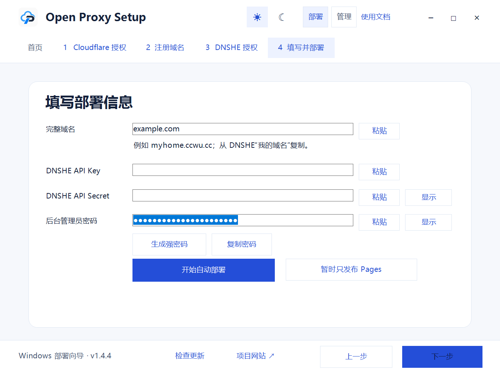
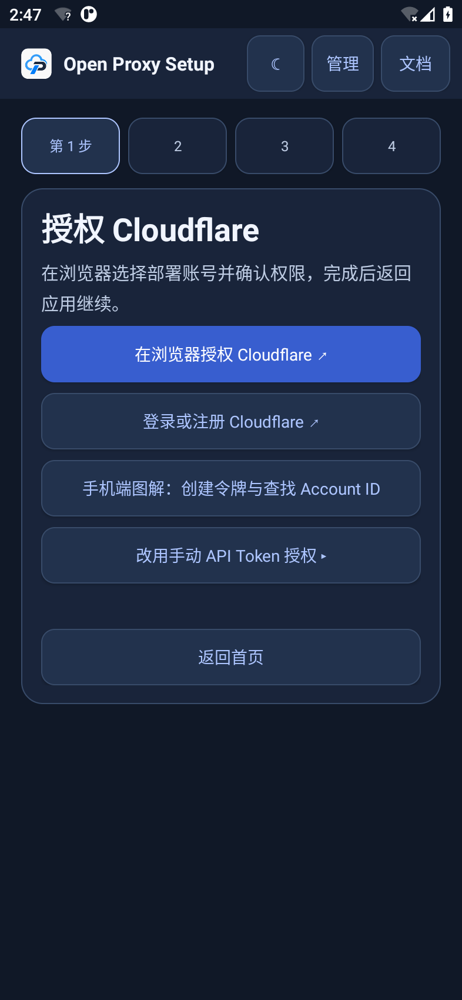

<!-- github-only-start -->

  
  <h1>Open Proxy Setup</h1>
  
<strong>自分の Cloudflare アカウントで、サイトのデプロイと管理を手軽に。</strong>

  
Windows・Android 向けウィザード · ブラウザー認証 · 複数サイト管理 · ライト／ダークモード

  

    <a href="README.md">简体中文</a> ·
    <a href="README.en.md">English</a> ·
    <a href="README.ja.md">日本語</a> ·
    <a href="README.ko.md">한국어</a>
  

  

    <a href="https://openproxysetup.ccwu.cc/">公式サイト</a> ·
    <a href="https://openproxysetup.ccwu.cc/docs/ja.html">ドキュメント</a> ·
    <a href="CHANGELOG.md">変更履歴</a> ·
    <a href="https://github.com/lomgzhijie/OpenProxySetup/issues/new/choose">問題を報告</a>
  

  

    
    
    
  

  

    
    
    
    
  

  

    <a href="https://github.com/lomgzhijie/OpenProxySetup/releases/download/v1.4.3/OpenProxySetup-windows-x64-setup.exe"><strong>⬇ Windows をダウンロード</strong></a>
    &nbsp; · &nbsp;
    <a href="https://github.com/lomgzhijie/OpenProxySetup/releases/download/v1.4.3/OpenProxySetup-android-v0.3.11.apk"><strong>⬇ Android をダウンロード</strong></a>
  

## 画面プレビュー

Android の画面を表示

Windows と Android の画面です。上のリンクから正式版をダウンロードできます。
<!-- github-only-end -->

## クイックスタート

今回の更新：強力なパスワードの生成、ドメイン入力の整形、前面の進行状況画面での30秒ごとのドメイン確認（最大5分）、サイトのメモ、管理画面URLのコピー、機密情報を除いた診断情報に対応しました。Windows は Pages のみの公開と Cloudflare アカウントの選択・切り替えに対応し、Android の手動トークン入力は初期状態で折りたたまれます。保存済みサイトを編集して認証すると独自ドメインに置き換わり、一時的な Pages アドレスを開いても独自ドメインを保持します。

OpenProxySetup は Windows と Android 向けのデプロイウィザードです。自分の Cloudflare アカウントでログインし、管理者パスワードを設定します。アプリは同梱の [edgetunnel](https://github.com/cmliu/edgetunnel) ソースを使って Cloudflare KV と Pages を作成し、サイトのリンクを表示します。サイトの `/admin` を開き、設定したパスワードでログインすると、上流プロジェクトの管理画面でノードやサブスクリプションリンクを確認できます。

本プロジェクトが提供するのはデプロイウィザードです。各ユーザーは自分の Cloudflare アカウントにデプロイします。共有ノード、アカウント、クラウドサービスの提供は対象外です。

起動時に新しいバージョンを確認し、更新があればダイアログを表示します。「下载更新」（更新をダウンロード）、「前往官网」（公式サイト）、「稍后」（後で）を選べます。Android のホーム画面や Windows のウィンドウ下部からも確認できます。ダウンロードしたインストーラーを開いて更新します。この機能は Android v0.3.5 と Windows v1.4.1 以降で利用できます。

## 利用するプラットフォーム

**初回のデプロイには Windows パソコンでの操作をおすすめします。** 大きな画面とキーボードで、ドメイン入力、Cloudflare と DNSHE の画面比較、認証情報のコピー、エラー表示の確認がしやすくなります。スマートフォンを使う場合も、Android 版でデプロイとサイト管理を行えます。

| 比較項目 | Windows 版 | Android 版 |
|---|---|---|
| 対応 OS | Windows 10/11、x64 | Android 8.0 以降 |
| Cloudflare 認証 | Wrangler によるブラウザー認証 | ブラウザー OAuth または API トークンの手動入力 |
| 初回設定 | キーボードと複数ウィンドウで設定や問題確認を進めやすい | タッチ入力でアプリとブラウザーを切り替えて設定 |
| デプロイ | KV と Pages の作成、管理者パスワード設定、DNSHE ドメインの接続 | KV と Pages の作成、管理者パスワード設定、DNSHE ドメインの接続 |
| サイト管理 | 複数サイト、パスワード検証、アプリ内管理画面、ライト／ダークモード | 複数サイト、パスワード検証、アプリ内管理画面、ライト／ダークモード |
| 配布形式 | EXE インストーラー、ポータブル ZIP、CMD 版 | APK |

両プラットフォームで Cloudflare と DNSHE に接続できるネットワークが必要です。デプロイしたサイトは対応クライアントで利用できます。操作しやすいプラットフォームを選んでください。

## Android 版 APK

### ダウンロードとインストール

**Android 8.0 以降**に対応しています。[Android v0.3.13 の APK](https://github.com/lomgzhijie/OpenProxySetup/releases/download/v1.4.3/OpenProxySetup-android-v0.3.11.apk) をダウンロードし、スマートフォンで開いてインストールまたは更新します。

### 初回デプロイ

1. **Cloudflare を認証します。** 「在浏览器授权 Cloudflare」をタップし、自分の Cloudflare アカウントでログインして許可します。アプリに戻り、選択画面が表示された場合はデプロイ先のアカウントを選びます。
2. **任意：API トークンを使います。** デプロイ先のアカウントに `Pages Write` と `Workers KV Storage Write` を付与したトークンを作成します。トークンと「アカウントの詳細」に表示される 32 文字の Account ID を入力し、認証を確認します。画面上部の番号をタップして手順を切り替えられます。
3. **DNSHE ドメインを用意します。** 手順 2 で DNSHE を開き、ドメインを登録します。登録済みの場合は、`myhome.ccwu.cc` のような完全なドメイン名をコピーします。
4. **DNSHE の API 認証情報を作成します。** DNSHE のモバイルサイトでドメイン管理のメニューを開き、鍵アイコンの API 管理を選びます。認証情報を作成し、API Key と API Secret をコピーします。
5. **デプロイを開始します。** 手順 4 でドメイン名、API Key、API Secret を入力し、12 文字以上の管理者パスワードを設定します。ドメインを後から追加する場合は、「暂时只发布 Pages」で Pages のみ公開できます。
6. **サイトの管理画面を開きます。** 公開後は `pages.dev` の管理画面に、設定したパスワードでログインできます。カスタムドメインの検証には約 5 分を見込んでください。1 分経過すると「重新验证」から状態を確認できます。検証が完了したらカスタムドメインの管理画面を開けます。 カスタムドメインの検証が完了すると、Android は同じデプロイで保存した一時的な `pages.dev` アドレスをカスタムドメインに置き換えます。

### 既存サイトを管理する

Windows と Android には「部署」（デプロイ）と「管理」の独立したページがあり、右上で切り替えられます。管理一覧にはドメイン名のみを表示し、複数サイトの追加・編集・削除に対応しています。旧版で保存した単一サイトの情報は自動で移行されます。

「添加站点」でドメインまたは HTTPS URL と管理者パスワードを入力し、「验证并保存」（検証して保存）または「验证并打开后台」（検証して管理画面を開く）を選びます。既存のブラウザー Cookie を再利用せず入力パスワードを検証し、保護された管理画面へのアクセスも確認してから保存・表示します。検証に失敗しても保存済みの正しいパスワードは上書きされません。保存済みサイトではパスワードを自動検証するため、再入力は不要です。

URL とパスワードは端末内に暗号化して保存されます。Windows は現在のユーザーの DPAPI、Android は Android Keystore と AES-GCM を使用します。サイトを個別に削除するか、すべての端末内サイト情報とログイン状態を消去できます。個別の削除では他のサイトは変更されません。Cloudflare と DNSHE の API 認証情報は保存対象に含まれません。内蔵管理画面は設定、ノード、サブスクリプション機能を保持し、アプリのライト・ダーク配色に連動します。

Windows の内蔵管理画面には Microsoft Edge WebView2 Runtime が必要です。Windows 11 には通常含まれています。未導入の場合は [Microsoft 公式ページ](https://developer.microsoft.com/microsoft-edge/webview2/)からインストールし、アプリを再起動してください。

## Windows 版のダウンロードと使い方

ホーム画面には法令に関する注意事項があり、「后台管理」（管理画面）に直接進むこともできます。デプロイ後はサイトが管理一覧に自動追加されます。右上の「管理」で保存済みサイトを開くか、別のサイトを追加・検証できます。

1. [Windows x64 インストーラー](https://github.com/lomgzhijie/OpenProxySetup/releases/download/v1.4.3/OpenProxySetup-windows-x64-setup.exe)をダウンロードして実行し、インストール先を選択します。「自建机场」フォルダーが作られ、ウィザードが開きます。次回からはフォルダー内の `OpenProxySetup.exe` をダブルクリックします。
2. 手順 1 で「开始 Cloudflare 授权」を選び、ブラウザーで [Cloudflare](https://dash.cloudflare.com/sign-up) に登録またはログインして認証します。ウィザードに戻り「我已完成授权，继续」を選びます。認証が確認されたら、手順 2 で [DNSHE](https://my.dnshe.com/) のドメインを取得し、手順 3 の「ドメイン管理 → API 管理」で API Key と API Secret を作成します。Cloudflare の認証情報は Cloudflare のサイトで入力します。
3. DNSHE ドメイン、API Key、API Secret、12 文字以上の管理者パスワードを入力してデプロイを開始します。アプリが KV、Pages、シークレットを作成してデプロイし、Pages にカスタムドメインの関連付けを申請します。さらに DNSHE API で `pages.dev` を指す CNAME を追加します。競合する既存の DNS レコードは保持されます。
4. デプロイ完了後、表示された管理画面を開き、設定したパスワードでログインします。ノードまたはサブスクリプションリンクをコピーし、対応クライアントにインポートします。利用できる形式はデプロイ時の上流バージョンに依存します。カスタムドメインが有効になるまでは、表示された `pages.dev` アドレスを使えます。

デプロイ進行画面では、Cloudflare の認証、KV の作成、Pages の公開、ドメインの関連付けの状況を確認できます。Pages の公開後は仮の管理画面を開けます。ドメインの関連付けに失敗した場合は、同じウィンドウで DNSHE の認証情報を修正し、関連付けを再試行すると、作成済みの Pages プロジェクトと KV を再利用できます。

デプロイ中もウィンドウを操作でき、経過時間を確認できます。ネットワークやブラウザー認証の状況により、おおむね 3〜10 分かかります。カスタムドメインの DNS と証明書が有効になるまで、さらに数分から数時間かかる場合があります。

DNSHE の API Key と API Secret は CNAME の追加に必要です。アプリは実行中のみ使用し、プロジェクトファイルには書き込みません。DNS レコードが競合する場合や DNSHE が書き込みを拒否した場合、既存レコードは保持されます。証明書の発行と DNS の反映を待つ間は、`pages.dev` の管理画面を使えます。Cloudflare Pages の公式ドキュメントでは、外部 DNS で管理するサブドメインを Cloudflare ゾーンに追加せず、CNAME で関連付けられます。

### 動作環境

- Windows 10 または Windows 11
- Cloudflare と DNSHE にアクセスできるネットワーク。Node.js、Wrangler、上流のノード用ソースは同梱されています。実行時に Git や Node.js を別途インストールする必要はありません。

## 対応クライアント

対応プラットフォームとクライアントは [edgetunnel の上流ドキュメント](https://github.com/cmliu/edgetunnel)を参照しています。インポート前に、使用するバージョンがサブスクリプション形式に対応しているか確認してください。

| プラットフォーム | クライアント |
| --- | --- |
| Windows | [v2rayN](https://github.com/2dust/v2rayN/releases), [Hiddify](https://github.com/hiddify/hiddify-app/releases), [FlClash](https://github.com/chen08209/FlClash/releases), [mihomo-party](https://github.com/mihomo-party-org/clash-party/releases), [Clash Verge Rev](https://github.com/clash-verge-rev/clash-verge-rev/releases), [Clashmi](https://github.com/KaringX/clashmi/releases), [FlyClash](https://github.com/GtxFury/FlyClash/releases), [Karing](https://github.com/KaringX/karing/releases), [Bettbox](https://github.com/appshubcc/Bettbox/releases) |
| Android | [v2rayNG](https://github.com/2dust/v2rayNG/releases), [ClashMetaForAndroid](https://github.com/MetaCubeX/ClashMetaForAndroid/releases/), [FlClash](https://github.com/chen08209/FlClash/releases), [Clashmi](https://github.com/KaringX/clashmi/releases), [Hiddify](https://github.com/hiddify/hiddify-app/releases), [NekoBox](https://github.com/MatsuriDayo/NekoBoxForAndroid/releases), [FlyClash](https://github.com/GtxFury/FlyClash/releases), [Karing](https://github.com/KaringX/karing/releases), [Bettbox](https://github.com/appshubcc/Bettbox/releases) |
| iOS | Surge, Shadowrocket, Stash, [Hiddify](https://github.com/hiddify/hiddify-app/releases), Loon, Egern, [Clashmi](https://github.com/KaringX/clashmi/releases), [Karing](https://github.com/KaringX/karing/releases), Quantumult X |
| macOS | [FlClash](https://github.com/chen08209/FlClash/releases), [mihomo-party](https://github.com/mihomo-party-org/clash-party/releases), [Clash Verge Rev](https://github.com/clash-verge-rev/clash-verge-rev/releases), Surge, [Clashmi](https://github.com/KaringX/clashmi/releases), [Karing](https://github.com/KaringX/karing/releases), [FlyClash](https://github.com/GtxFury/FlyClash/releases) |
| HarmonyOS | [ClashBox](https://github.com/xiaobaigroup/ClashBox/releases) |

## ZIP ポータブル版

`OpenProxySetup-windows-x64-portable.zip` をすべて展開し、`OpenProxySetup.exe` をダブルクリックします。EXE、`runtime`、`vendor`、各スクリプトは同じフォルダーに置いてください。Windows の .NET Framework と Windows PowerShell 5.1 を使用します。起動に失敗した場合は、`启动应用.cmd` を実行してエラーを確認できます。

[v1.4.4 CMD 版](https://github.com/lomgzhijie/OpenProxySetup/releases/download/v1.4.3/OpenProxySetup-windows-x64-cmd-v1.4.3.zip)も利用できます。ZIP をすべて展開し、`OpenProxySetup.cmd` をダブルクリックしてください。

## メンテナー向けのパッケージ作成

PowerShell で `npm ci --prefix runtime` を実行して指定バージョンの Wrangler をインストールし、Windows x64 版の `node.exe` と `NODE-LICENSE` を `runtime` に置きます。Windows PowerShell 5.1 で `./打包发布.ps1` を実行すると、EXE をコンパイルして ポータブル版と CMD 版の ZIP を作成します。ランチャーだけをコンパイルする場合は `./构建应用.ps1`、ZIP からインストーラー EXE を作成する場合は `./构建安装程序.ps1` を実行します。ランチャーのソースは `launcher/Launcher.cs` にあります。これらのコマンドはメンテナー向けです。ソースから起動する場合は `./app.ps1` を実行します。

## 動作の仕組みと範囲

1. パッケージにはバージョンを固定した上流の `_worker.js`、GPL-2.0 ライセンス、コミット ID を同梱しています。実行時は同梱ファイルを使用し、`git clone` は行いません。
2. Cloudflare 公式の Wrangler CLI でブラウザー認証、KV の作成、`ADMIN` シークレットの設定、Pages プロジェクトの作成とデプロイを行います。Cloudflare Pages API でカスタムドメインを関連付け、DNSHE API で CNAME を追加します。
3. アプリは管理画面のアドレス `https://<プロジェクト名>.pages.dev/admin` を表示します。サブスクリプションリンクは上流の管理画面で生成されます。

管理者パスワードは現在のプロセスから Cloudflare に渡され、プロジェクトファイルには保存されません。パスワードやサブスクリプションリンクは公開しないでください。Cloudflare の無料枠、プラットフォームのルール、上流機能は変更される可能性があります。利用時は現地の法令と利用規約に従ってください。

## 出典とライセンス

本プロジェクトは [edgetunnel の上流コード](https://github.com/cmliu/edgetunnel) を使用し、デプロイは [Cloudflare Pages のドキュメント](https://developers.cloudflare.com/pages/) を参照しています。このリポジトリ独自のスクリプトとドキュメントは MIT ライセンス、同梱の上流コードは GPL-2.0 ライセンスです。詳細は `vendor/edgetunnel/LICENSE` を参照してください。同梱の Node.js のライセンスは `runtime/NODE-LICENSE` にあり、Wrangler と依存関係のライセンスは npm パッケージに含まれています。再配布時には該当するソースコードとライセンスを保持してください。

同梱の edgetunnel ソースと GPL-2.0 ライセンスは[固定した上流コミット](https://github.com/cmliu/edgetunnel/tree/a8ab11125ece9bc27983f609a6359be81b21050c)と一致します。デプロイスクリプトは同梱の `_worker.js` をそのままコピーします。各リリースのアプリのソースとビルドスクリプトは `Source code (zip)` から入手できます。
