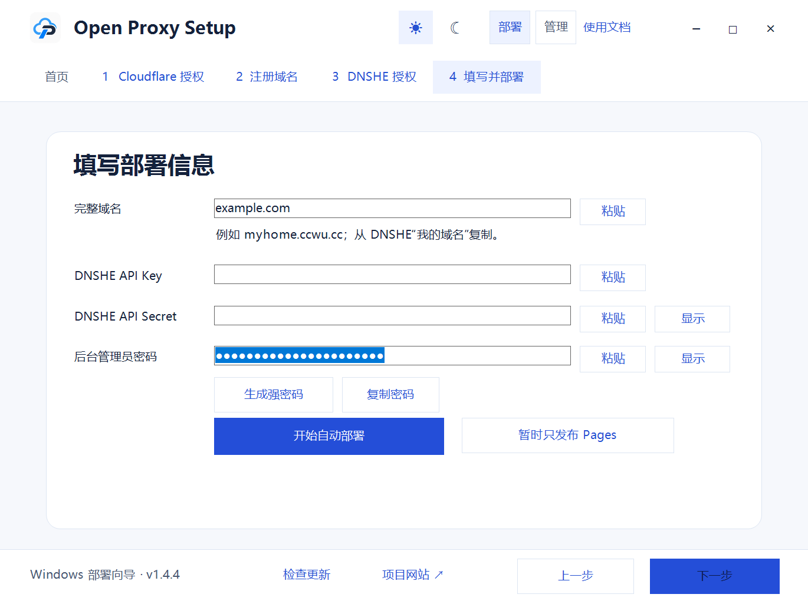
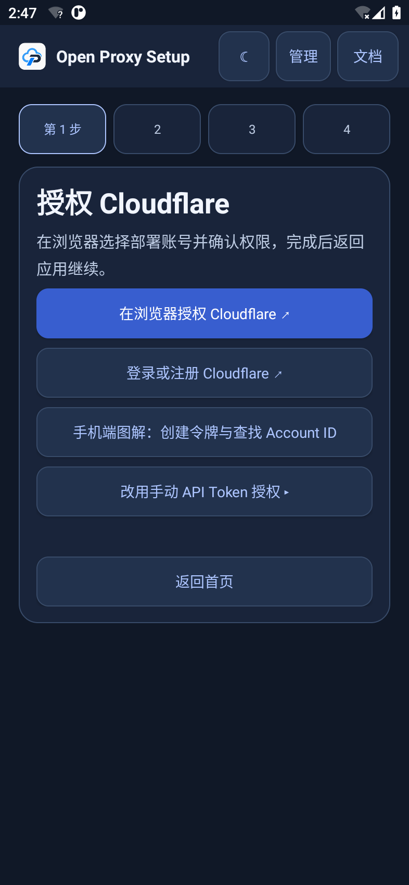

<!-- github-only-start -->

  
  <h1>Open Proxy Setup</h1>
  
<strong>내 Cloudflare 계정으로 사이트를 간편하게 배포하고 관리하세요.</strong>

  
Windows·Android 배포 마법사 · 브라우저 인증 · 여러 사이트 관리 · 라이트／다크 모드

  

    <a href="README.md">简体中文</a> ·
    <a href="README.en.md">English</a> ·
    <a href="README.ja.md">日本語</a> ·
    <a href="README.ko.md">한국어</a>
  

  

    <a href="https://openproxysetup.ccwu.cc/">공식 사이트</a> ·
    <a href="https://openproxysetup.ccwu.cc/docs/ko.html">사용 문서</a> ·
    <a href="CHANGELOG.md">변경 기록</a> ·
    <a href="https://github.com/lomgzhijie/OpenProxySetup/issues/new/choose">문제 신고</a>
  

  

    
    
    
  

  

    
    
    
    
  

  

    <a href="https://github.com/lomgzhijie/OpenProxySetup/releases/download/v1.4.3/OpenProxySetup-windows-x64-setup.exe"><strong>⬇ Windows 다운로드</strong></a>
    &nbsp; · &nbsp;
    <a href="https://github.com/lomgzhijie/OpenProxySetup/releases/download/v1.4.3/OpenProxySetup-android-v0.3.11.apk"><strong>⬇ Android 다운로드</strong></a>
  

## 화면 미리 보기

Android 화면 펼치기

Windows와 Android 앱 화면입니다. 위 링크에서 정식 설치 파일을 다운로드하세요.
<!-- github-only-end -->

## 빠른 시작

이번 업데이트: 강력한 비밀번호 생성, 도메인 입력 정리, 전면 진행 화면에서 30초 간격 도메인 상태 확인(최대 5분), 사이트 메모, 관리 URL 복사, 민감 정보를 제외한 진단 복사를 지원합니다. Windows는 Pages만 배포하기와 Cloudflare 계정 선택·전환을 지원하며, Android의 수동 토큰 입력은 기본적으로 접혀 있습니다. 저장된 사이트를 편집하고 인증하면 임시 주소가 사용자 도메인으로 바뀌며, Pages 임시 주소를 다시 열어도 사용자 도메인이 유지됩니다.

OpenProxySetup은 Windows와 Android용 배포 마법사를 제공합니다. 본인의 Cloudflare 계정으로 로그인하고 관리자 비밀번호를 설정합니다. 앱은 함께 제공되는 [edgetunnel](https://github.com/cmliu/edgetunnel) 소스로 Cloudflare KV와 Pages를 만들고 클릭할 수 있는 사이트 주소를 표시합니다. 사이트의 `/admin`에 접속해 설정한 비밀번호로 로그인하면 업스트림 관리 화면에서 노드와 구독 링크를 확인할 수 있습니다.

이 프로젝트는 배포 마법사를 제공합니다. 각 사용자는 본인의 Cloudflare 계정에 배포합니다. 공유 노드, 계정, 클라우드 서비스 제공은 프로젝트 범위에 포함되지 않습니다.

앱을 시작하면 새 버전을 확인하고 업데이트가 있을 때 알림 창을 표시합니다. 「下载更新」(업데이트 다운로드), 「前往官网」(공식 사이트), 「稍后」(나중에)를 선택할 수 있습니다. Android 홈 화면과 Windows 창 하단에서도 직접 확인할 수 있습니다. 내려받은 설치 파일을 열어 업데이트하세요. 이 기능은 Android v0.3.5와 Windows v1.4.1부터 지원합니다.

## 사용할 플랫폼 선택

**처음 배포할 때는 Windows 컴퓨터 사용을 권장합니다.** 큰 화면과 키보드로 도메인 입력, Cloudflare와 DNSHE 화면 비교, 인증 정보 복사, 오류 메시지 확인을 편하게 할 수 있습니다. 휴대전화를 사용하는 경우 Android 앱에서도 배포와 사이트 관리를 완료할 수 있습니다.

| 비교 항목 | Windows | Android |
|---|---|---|
| 시스템 요구 사항 | Windows 10/11, x64 | Android 8.0 이상 |
| Cloudflare 인증 | Wrangler를 통한 브라우저 인증 | 브라우저 OAuth 또는 API 토큰 직접 입력 |
| 초기 설정 | 키보드와 여러 창을 활용해 첫 설정과 문제 확인을 진행 | 앱과 브라우저를 전환하며 터치로 입력 |
| 배포 | KV와 Pages 생성, 관리자 비밀번호 설정, DNSHE 도메인 연결 | KV와 Pages 생성, 관리자 비밀번호 설정, DNSHE 도메인 연결 |
| 사이트 관리 | 여러 사이트 저장, 비밀번호 검증, 앱 내 관리 화면, 밝은／어두운 모드 | 여러 사이트 저장, 비밀번호 검증, 앱 내 관리 화면, 밝은／어두운 모드 |
| 설치 형식 | EXE 설치 파일, 포터블 ZIP, CMD 버전 | APK |

두 플랫폼 모두 Cloudflare와 DNSHE에 접속할 수 있는 네트워크가 필요합니다. 배포한 사이트는 호환 클라이언트에서 사용할 수 있으므로 작업하기 편한 플랫폼을 선택하세요.

## Android APK

### 다운로드 및 설치

**Android 8.0 이상**을 지원합니다. [Android v0.3.13 APK](https://github.com/lomgzhijie/OpenProxySetup/releases/download/v1.4.3/OpenProxySetup-android-v0.3.11.apk)를 내려받아 휴대전화에서 열면 앱을 설치하거나 업데이트할 수 있습니다.

### 처음 배포하기

1. **Cloudflare를 인증합니다.** 「在浏览器授权 Cloudflare」를 누르고 본인의 Cloudflare 계정으로 로그인해 권한을 승인합니다. 앱으로 돌아온 뒤 선택 화면이 나타나면 배포할 계정을 선택합니다.
2. **선택 사항: API 토큰을 사용합니다.** 배포할 계정에 `Pages Write`와 `Workers KV Storage Write` 권한이 있는 토큰을 만듭니다. 토큰과 계정 세부 정보의 32자리 Account ID를 입력한 뒤 인증을 확인합니다. 화면 상단의 번호를 누르면 단계 사이를 이동할 수 있습니다.
3. **DNSHE 도메인을 준비합니다.** 2단계에서 DNSHE를 열어 새 도메인을 등록하거나 `myhome.ccwu.cc`와 같은 기존 도메인의 전체 이름을 복사합니다.
4. **DNSHE API 인증 정보를 만듭니다.** DNSHE 모바일 사이트에서 도메인 관리 메뉴를 펼쳐 열쇠 아이콘이 있는 API 관리로 이동합니다. 인증 정보를 만들고 API Key와 API Secret을 각각 복사합니다.
5. **배포를 시작합니다.** 4단계에서 도메인 전체 이름, API Key, API Secret을 입력하고 12자 이상의 관리자 비밀번호를 설정합니다. 나중에 도메인을 연결하려면 「暂时只发布 Pages」를 선택해 Pages만 게시할 수 있습니다.
6. **관리 화면을 엽니다.** Pages 게시 후에는 설정한 비밀번호로 `pages.dev` 관리 화면에 로그인할 수 있습니다. 사용자 지정 도메인 검증에는 약 5분을 예상하세요. 1분이 지나면 「重新验证」 버튼으로 상태를 확인할 수 있습니다. 검증이 완료되면 사용자 지정 도메인으로 관리 화면을 열 수 있습니다. 사용자 지정 도메인이 검증되면 Android는 해당 배포에 저장한 임시 `pages.dev` 주소를 사용자 지정 도메인으로 바꿉니다.

### 기존 사이트 관리

Windows와 Android에는 별도의 「部署」(배포) 페이지와 「管理」(관리) 페이지가 있으며 오른쪽 위에서 전환할 수 있습니다. 관리 목록에는 도메인 이름만 표시되며 여러 사이트를 추가·편집·삭제할 수 있습니다. 이전 버전의 단일 사이트 기록은 자동으로 이전됩니다.

「添加站点」에서 도메인 또는 HTTPS 주소와 관리자 비밀번호를 입력하고 「验证并保存」(검증 후 저장) 또는 「验证并打开后台」(검증 후 관리 화면 열기)를 선택하세요. 앱은 기존 브라우저 쿠키를 재사용하지 않고 입력한 비밀번호를 검증하며, 보호된 관리 화면 접근도 확인한 뒤 저장하거나 엽니다. 검증 실패 시 기존에 저장한 올바른 비밀번호를 덮어쓰지 않습니다. 저장된 사이트를 열 때는 비밀번호를 자동 검증하므로 다시 입력할 필요가 없습니다.

주소와 비밀번호는 기기에 암호화하여 저장됩니다. Windows는 현재 사용자의 DPAPI를, Android는 Android Keystore와 AES-GCM을 사용합니다. 사이트 하나만 삭제하거나 모든 기기 내 사이트 정보와 로그인 상태를 지울 수 있습니다. 개별 삭제는 다른 사이트에 영향을 주지 않습니다. Cloudflare와 DNSHE API 인증 정보는 이 저장 기능에 포함되지 않습니다. 내장 관리 화면은 설정·노드·구독 기능을 유지하며 앱의 주간·야간 색상을 따릅니다.

Windows 내장 관리 화면에는 Microsoft Edge WebView2 Runtime이 필요합니다. Windows 11에는 일반적으로 포함되어 있습니다. 없다면 [Microsoft 공식 페이지](https://developer.microsoft.com/microsoft-edge/webview2/)에서 설치하고 앱을 다시 실행하세요.

## Windows 버전 다운로드 및 사용

홈 화면에 법률 관련 안내가 표시되며 「后台管理」(관리 화면)로 바로 이동할 수도 있습니다. 배포에 성공하면 사이트가 관리 목록에 자동으로 추가됩니다. 오른쪽 위 「管理」에서 저장된 사이트를 열거나 다른 사이트를 추가·검증할 수 있습니다.

1. [Windows x64 설치 프로그램](https://github.com/lomgzhijie/OpenProxySetup/releases/download/v1.4.3/OpenProxySetup-windows-x64-setup.exe)을 다운로드하고 실행한 뒤 설치 위치를 선택합니다. 설치 프로그램이 `自建机场` 폴더를 만들고 배포 마법사를 엽니다. 다음부터는 이 폴더의 `OpenProxySetup.exe`를 실행합니다.
2. 1단계에서 ‘开始 Cloudflare 授权’을 눌러 브라우저에서 [Cloudflare](https://dash.cloudflare.com/sign-up)에 가입하거나 로그인하고 인증을 완료합니다. 마법사로 돌아와 ‘我已完成授权，继续’를 선택합니다. 인증이 확인되면 2단계에서 [DNSHE](https://my.dnshe.com/) 도메인을 발급받고 3단계의 ‘도메인 관리 → API 관리’에서 API Key와 API Secret을 만듭니다. Cloudflare 계정 정보는 Cloudflare 웹사이트에서 입력합니다.
3. DNSHE 도메인, API Key, API Secret, 12자 이상의 관리자 비밀번호를 입력하고 배포를 시작합니다. 앱이 KV, Pages, 시크릿을 만들고 배포한 다음 Pages에 사용자 지정 도메인 연결을 요청합니다. DNSHE API로 `pages.dev`를 가리키는 CNAME도 추가합니다. 충돌하는 기존 DNS 레코드는 보존합니다.
4. 배포가 끝나면 앱에 표시된 관리 주소를 열고 설정한 비밀번호로 로그인합니다. 관리 화면에서 노드 또는 구독 링크를 복사해 호환 클라이언트에 가져옵니다. 사용 가능한 형식은 배포에 사용한 업스트림 버전에 따라 달라집니다. 사용자 지정 도메인이 활성화될 때까지 앱에 표시된 `pages.dev` 주소를 사용할 수 있습니다.

배포 진행 화면에서 Cloudflare 인증, KV 생성, Pages 게시, 도메인 연결 상태를 확인할 수 있습니다. Pages를 게시하면 임시 관리자 주소를 열 수 있습니다. 도메인 연결이 실패하면 같은 창에서 DNSHE 자격 증명을 수정하고 도메인 연결을 다시 시도해 기존 Pages 프로젝트와 KV를 재사용할 수 있습니다.

배포 중에도 창을 사용할 수 있으며 경과 시간이 표시됩니다. 네트워크와 브라우저 인증 상태에 따라 보통 약 3~10분이 걸립니다. 사용자 지정 도메인의 DNS와 인증서가 활성화되기까지 몇 분에서 몇 시간이 더 걸릴 수 있습니다.

CNAME을 추가하려면 DNSHE API Key와 API Secret이 필요합니다. 앱은 현재 실행 중에만 이 값을 사용하며 프로젝트 파일에 기록하지 않습니다. 기존 DNS 레코드가 충돌하거나 DNSHE가 쓰기를 거부하면 기존 레코드를 보존합니다. 인증서 발급과 DNS 전파를 기다리는 동안에는 `pages.dev` 관리 주소를 사용할 수 있습니다. Cloudflare Pages 공식 문서에 따르면 외부 DNS에서 관리하는 하위 도메인을 별도의 Cloudflare 영역으로 만들지 않고 CNAME을 통해 연결할 수 있습니다.

### 시스템 요구 사항

- Windows 10 또는 Windows 11
- Cloudflare와 DNSHE에 접속 가능한 네트워크. Node.js, Wrangler, 업스트림 노드 소스가 포함되어 있어 Git이나 Node.js를 따로 설치할 필요가 없습니다.

## 지원 클라이언트

플랫폼과 클라이언트 목록은 [edgetunnel 업스트림 문서](https://github.com/cmliu/edgetunnel)를 참고했습니다. 가져오기 전에 사용 중인 클라이언트 버전이 구독 형식을 지원하는지 확인하세요.

| 플랫폼 | 클라이언트 |
| --- | --- |
| Windows | [v2rayN](https://github.com/2dust/v2rayN/releases), [Hiddify](https://github.com/hiddify/hiddify-app/releases), [FlClash](https://github.com/chen08209/FlClash/releases), [mihomo-party](https://github.com/mihomo-party-org/clash-party/releases), [Clash Verge Rev](https://github.com/clash-verge-rev/clash-verge-rev/releases), [Clashmi](https://github.com/KaringX/clashmi/releases), [FlyClash](https://github.com/GtxFury/FlyClash/releases), [Karing](https://github.com/KaringX/karing/releases), [Bettbox](https://github.com/appshubcc/Bettbox/releases) |
| Android | [v2rayNG](https://github.com/2dust/v2rayNG/releases), [ClashMetaForAndroid](https://github.com/MetaCubeX/ClashMetaForAndroid/releases/), [FlClash](https://github.com/chen08209/FlClash/releases), [Clashmi](https://github.com/KaringX/clashmi/releases), [Hiddify](https://github.com/hiddify/hiddify-app/releases), [NekoBox](https://github.com/MatsuriDayo/NekoBoxForAndroid/releases), [FlyClash](https://github.com/GtxFury/FlyClash/releases), [Karing](https://github.com/KaringX/karing/releases), [Bettbox](https://github.com/appshubcc/Bettbox/releases) |
| iOS | Surge, Shadowrocket, Stash, [Hiddify](https://github.com/hiddify/hiddify-app/releases), Loon, Egern, [Clashmi](https://github.com/KaringX/clashmi/releases), [Karing](https://github.com/KaringX/karing/releases), Quantumult X |
| macOS | [FlClash](https://github.com/chen08209/FlClash/releases), [mihomo-party](https://github.com/mihomo-party-org/clash-party/releases), [Clash Verge Rev](https://github.com/clash-verge-rev/clash-verge-rev/releases), Surge, [Clashmi](https://github.com/KaringX/clashmi/releases), [Karing](https://github.com/KaringX/karing/releases), [FlyClash](https://github.com/GtxFury/FlyClash/releases) |
| HarmonyOS | [ClashBox](https://github.com/xiaobaigroup/ClashBox/releases) |

## ZIP 포터블 버전

`OpenProxySetup-windows-x64-portable.zip`의 전체 압축을 푼 후 `OpenProxySetup.exe`를 더블 클릭합니다. EXE, `runtime`, `vendor`, 스크립트를 같은 폴더에 둡니다. Windows의 .NET Framework와 Windows PowerShell 5.1을 사용합니다. 시작에 실패하면 `启动应用.cmd`를 실행해 오류를 확인할 수 있습니다.

[v1.4.4 CMD 버전](https://github.com/lomgzhijie/OpenProxySetup/releases/download/v1.4.3/OpenProxySetup-windows-x64-cmd-v1.4.3.zip)도 사용할 수 있습니다. ZIP 파일의 압축을 모두 풀고 `OpenProxySetup.cmd`를 더블 클릭하세요.

## 유지보수용 패키징

PowerShell에서 `npm ci --prefix runtime`을 실행하여 고정된 버전의 Wrangler를 설치하고 Windows x64용 `node.exe`와 `NODE-LICENSE`를 `runtime`에 놓습니다. Windows PowerShell 5.1에서 `./打包发布.ps1`을 실행하면 EXE를 컴파일하고 포터블 ZIP과 CMD ZIP을 생성합니다. 런처만 컴파일하려면 `./构建应用.ps1`을 실행하고 ZIP을 설치 EXE로 만들려면 `./构建安装程序.ps1`을 실행합니다. 런처 소스는 `launcher/Launcher.cs`에 있습니다. 이 명령은 유지보수용입니다. 소스에서 바로 실행하려면 `./app.ps1`을 사용합니다.

## 작동 방식과 범위

1. 패키지에는 버전이 고정된 업스트림 `_worker.js`, GPL-2.0 라이선스, 업스트림 커밋 ID가 포함됩니다. 실행 시 동봉된 파일을 사용하므로 `git clone`을 실행하지 않습니다.
2. Cloudflare 공식 Wrangler CLI로 브라우저 인증을 완료하고 KV를 생성하고 `ADMIN` 시크릿을 설정한 뒤 Pages 프로젝트를 만들고 배포합니다. Cloudflare Pages API로 사용자 지정 도메인을 연결하고 DNSHE API로 CNAME을 추가합니다.
3. 앱에는 관리 화면 주소인 `https://<프로젝트-이름>.pages.dev/admin`이 표시됩니다. 구독 링크는 업스트림 관리 화면에서 생성됩니다.

관리자 비밀번호는 현재 프로세스에서 Cloudflare에 전달되며 프로젝트 파일에는 저장되지 않습니다. 비밀번호와 구독 링크는 공개하지 마세요. Cloudflare 무료 할당량, 플랫폼 규칙, 업스트림 기능은 바뀔 수 있습니다. 현지 법률과 서비스 약관을 준수하세요.

## 출처 및 라이선스

이 프로젝트는 [edgetunnel 업스트림 코드](https://github.com/cmliu/edgetunnel)를 사용하며 배포 과정은 [Cloudflare Pages 문서](https://developers.cloudflare.com/pages/)를 참고합니다. 저장소 자체의 스크립트와 문서는 MIT 라이선스이며, 함께 제공되는 업스트림 코드는 GPL-2.0 라이선스입니다. 자세한 내용은 `vendor/edgetunnel/LICENSE`를 참조하세요. Node.js 라이선스는 `runtime/NODE-LICENSE`에 있으며 Wrangler와 종속 패키지의 라이선스는 npm 패키지에 포함됩니다. 재배포할 때는 해당 소스 코드와 라이선스를 보존해야 합니다.

동봉한 edgetunnel 소스와 GPL-2.0 라이선스는 [고정된 업스트림 커밋](https://github.com/cmliu/edgetunnel/tree/a8ab11125ece9bc27983f609a6359be81b21050c)과 일치합니다. 배포 스크립트는 동봉된 `_worker.js`를 그대로 복사합니다. 각 릴리스의 앱 소스와 빌드 스크립트는 `Source code (zip)`에서 받을 수 있습니다.
