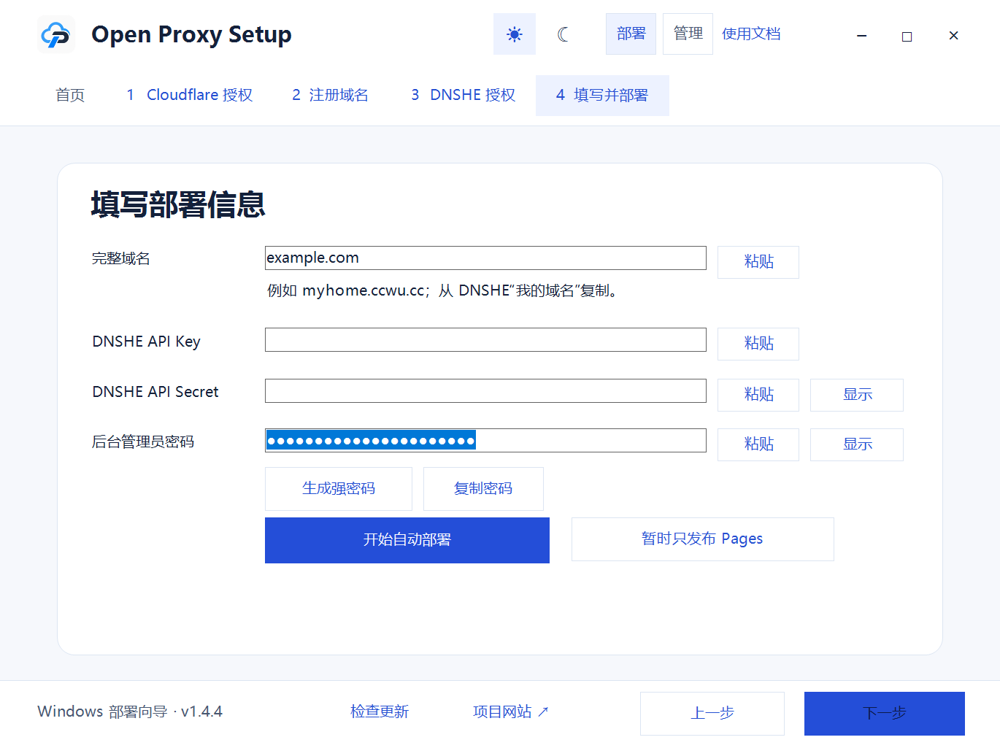
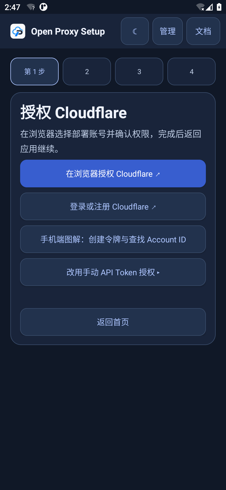

<!-- github-only-start -->
<div align="center">
  
  <h1>Open Proxy Setup</h1>
  <p><strong>用自己的 Cloudflare 账号，轻松部署和管理站点。</strong></p>
  <p>Windows 与 Android 部署向导 · 浏览器授权 · 多站点管理 · 日间与暗夜模式</p>
  <p>
    <a href="README.md">简体中文</a> ·
    <a href="README.en.md">English</a> ·
    <a href="README.ja.md">日本語</a> ·
    <a href="README.ko.md">한국어</a>
  </p>
  <p>
    <a href="https://openproxysetup.ccwu.cc/">官网</a> ·
    <a href="https://openproxysetup.ccwu.cc/docs/">使用文档</a> ·
    <a href="CHANGELOG.md">更新日志</a> ·
    <a href="https://github.com/lomgzhijie/OpenProxySetup/issues/new/choose">问题反馈</a>
  </p>
  <p>
    <a href="https://github.com/lomgzhijie/OpenProxySetup/releases/latest"></a>
    
    
  </p>
  <p>
    <a href="https://github.com/lomgzhijie/OpenProxySetup/actions/workflows/check.yml"></a>
    <a href="https://github.com/lomgzhijie/OpenProxySetup/actions/workflows/android.yml"></a>
    <a href="LICENSE"></a>
    <a href="vendor/edgetunnel/LICENSE"></a>
  </p>
  <p>
    <a href="https://github.com/lomgzhijie/OpenProxySetup/releases/download/v1.4.4/OpenProxySetup-windows-x64-setup.exe"><strong>⬇ 下载 Windows</strong></a>
    &nbsp; · &nbsp;
    <a href="https://github.com/lomgzhijie/OpenProxySetup/releases/download/v1.4.4/OpenProxySetup-android-v0.3.13.apk"><strong>⬇ 下载 Android</strong></a>
  </p>
</div>

## 界面预览

<p align="center"></p>

<details>
<summary>展开 Android 界面</summary>
<p align="center"></p>
</details>

Windows 与 Android 应用界面；请从上方入口下载正式安装包。
<!-- github-only-end -->

## 快速开始

本次更新：可生成强密码，自动整理域名，前台每 30 秒复查域名验证状态（最多 5 分钟），支持站点备注、复制后台网址和脱敏诊断。Windows 可仅发布 Pages、选择或切换 Cloudflare 账户；Android 手动 Token 入口默认折叠。编辑站点并验证保存后，自定义域名会替换原临时地址，再打开临时后台也会保留自定义域名。

OpenProxySetup 提供 Windows 和 Android 部署向导。用户授权自己的 Cloudflare 账号，并设置后台管理员密码，应用使用包内的 [edgetunnel](https://github.com/cmliu/edgetunnel) 源码创建 Cloudflare KV 和 Pages，并给出可点击的网站地址。用户访问网站的 `/admin`，输入刚设置的密码，即可在上游后台查看节点和订阅链接。

本项目提供部署向导，不提供共享节点、账号或云服务。每位用户部署到自己的 Cloudflare 账号。

启动时会自动检查新版本，发现更新后弹窗提示，可选「下载更新」「前往官网」或「稍后」。Android 首页和 Windows 窗口底部也有「检查更新」。下载后运行安装包更新，Android 可覆盖安装。首次使用此功能需先安装 Android v0.3.5 或 Windows v1.4.1。

## 选择使用平台

**首次部署建议优先使用 Windows 电脑操作。** 电脑屏幕更大，填写域名、切换 Cloudflare 与 DNSHE 页面、复制授权信息和查看错误提示更方便。只有手机时，也可以使用 Android 版完成部署和管理。

| 对比项目 | Windows 版 | Android 版 |
|---|---|---|
| 系统要求 | Windows 10/11，x64 | Android 8.0 及以上 |
| Cloudflare 授权 | 通过 Wrangler 打开浏览器授权 | 浏览器 OAuth 授权，也可手动填写 API Token |
| 首次配置 | 键盘输入、多窗口对照，适合第一次部署和排查问题 | 触屏填写，需要在应用和浏览器间切换 |
| 部署功能 | 创建 KV 和 Pages、配置管理员密码、绑定 DNSHE 域名 | 创建 KV 和 Pages、配置管理员密码、绑定 DNSHE 域名 |
| 站点管理 | 多站点保存、密码验证、应用内后台、日间／暗夜模式 | 多站点保存、密码验证、应用内后台、日间／暗夜模式 |
| 安装方式 | EXE 安装版、ZIP 免安装版、CMD 版 | APK 安装版 |

两端都需要能访问 Cloudflare 和 DNSHE 的网络。部署后的站点可在兼容客户端使用，部署时使用的平台可按操作习惯选择。

## Android 安装版

### 下载和安装

支持 **Android 8.0 及以上**。下载 [Android v0.3.13 安装包](https://github.com/lomgzhijie/OpenProxySetup/releases/download/v1.4.4/OpenProxySetup-android-v0.3.13.apk) 后，在手机上打开 APK 安装。已安装旧版可直接覆盖安装。

### 首次部署

1. **授权 Cloudflare。** 点「在浏览器授权 Cloudflare」，用自己的 Cloudflare 账号登录并同意授权。返回应用后选择要部署的账户（如果出现账户列表）。
2. **可选：使用 API Token。** 在自己的目标账户上创建拥有 `Pages Write` 和 `Workers KV Storage Write` 的令牌。把令牌和「账户详情」里的 32 位 Account ID 填入应用，再点「验证授权并继续」。顶部步骤可点击切换。
3. **准备 DNSHE 域名。** 在第 2 步打开 DNSHE，注册新域名或从「我的域名」复制已注册的完整域名，例如 `myhome.ccwu.cc`。
4. **创建 DNSHE 授权。** 在 DNSHE 手机网页展开上方「域名管理」，在「功能导航」里点带钥匙图标的「API 管理」，创建并复制 API Key 和 API Secret。
5. **开始部署。** 在第 4 步填写完整域名、API Key 和 API Secret，再设置至少 12 个字符的后台管理员密码，点「开始自动部署」。暂时没有域名时，可选「暂时只发布 Pages」，以后再绑定。
6. **打开站点后台。** Pages 发布后可先点「打开 Pages 后台」，用刚设置的密码登录。自定义域名验证建议预留约 5 分钟。等满 1 分钟还在等待时，可点「重新验证」查询状态。验证成功后即可打开自定义域名后台。 自定义域名验证成功后，Android 会用它替换同一次部署保存的 `pages.dev` 临时地址。

### 管理已有站点

Windows 与 Android 均提供独立的「部署」和「管理」页面，可在右上角切换。管理列表只显示域名，支持保存多个站点，以及添加、编辑和移除。旧版保存的单个站点会自动迁移。

在「管理」页面点击「添加站点」，输入域名或 HTTPS 网址及后台密码，然后选择「验证并保存」或「验证并打开后台」。应用独立检查输入的密码，不复用浏览器已有的登录 Cookie；密码及受保护后台均验证成功后才保存或打开。验证失败不会覆盖原先保存的正确密码。打开已保存站点时会自动用所存密码验证，无需再次输入。

网址和密码加密保存在本机，Windows 使用当前用户的 DPAPI，Android 使用 Android Keystore 与 AES-GCM。可以单独移除一个站点，或清除全部本机站点与登录会话。移除一个站点不会删除其他站点。Cloudflare 与 DNSHE 的 API 凭据不包含在此保存功能中。内置后台保留原有设置、节点和订阅操作，配色跟随日间与暗夜模式。

Windows 内置后台使用 Microsoft Edge WebView2 Runtime。Windows 11 通常已包含此组件；缺失时请从 [Microsoft 官方页面](https://developer.microsoft.com/microsoft-edge/webview2/) 安装后重新打开应用。

## Windows 版下载与使用

点击首页「开始部署」时会弹出网络提醒，请先开启可访问 Cloudflare 和 DNSHE 的 VPN／代理环境，并遵守所在地适用的法律法规。你也可直接进入「后台管理」。部署成功后会自动加入站点列表；已有站点可手动添加并验证。可在右上角切换到「管理」，从站点列表打开后台，或添加并验证其他站点。

1. 下载 [Windows x64 安装程序](https://github.com/lomgzhijie/OpenProxySetup/releases/download/v1.4.4/OpenProxySetup-windows-x64-setup.exe)，双击运行并选择安装位置。安装程序会创建「自建机场」文件夹并打开部署向导。之后可从该目录双击 OpenProxySetup.exe。
2. 先在应用第 1 步点击「开始 Cloudflare 授权」，在浏览器注册或登录 [Cloudflare](https://dash.cloudflare.com/sign-up) 并完成授权，再回到向导点击「我已完成授权，继续」。授权验证后，在第 2 步从 [DNSHE](https://my.dnshe.com/) 获取域名，在第 3 步通过「域名管理 → API 管理」创建 API Key 和 API Secret。Cloudflare 账号密码只在 Cloudflare 网站输入。
3. 在应用中填写 DNSHE 域名、API Key / Secret，并设置至少 12 位的后台管理员密码，然后点击部署。应用负责创建 KV、Pages、密钥并部署，然后向 Pages 提交自定义域名绑定，通过 DNSHE API 为该域名添加指向 `pages.dev` 的 CNAME。已有的冲突 DNS 记录不会被覆盖。
4. 部署成功后点击应用显示的后台网址，输入刚才设置的密码。在后台复制需要的节点或订阅链接，导入兼容客户端。实际可用格式由部署时的上游版本决定。自定义域名生效前，先使用应用显示的 `pages.dev` 地址。

「部署进度」显示 Cloudflare 授权、KV 创建、Pages 发布和域名绑定的状态。Pages 发布后可先打开临时后台。域名绑定失败时，在同一个应用窗口修改 DNSHE 授权，并点击「重试域名绑定」，继续使用已创建的 Pages 和 KV。

点击部署后窗口会保持可操作，并显示已用时间。部署通常估计需要约 3–10 分钟，取决于网络和浏览器授权；自定义域名的 DNS 与证书生效可能另需数分钟至数小时。

DNSHE 的 API Key / Secret 是添加 CNAME 所必需的授权。应用只在本次运行中使用它们，不写入项目文件。如果该域名已有 DNS 记录或 DNSHE 拒绝写入，应用不会覆盖原记录。Cloudflare 证书签发和 DNS 传播可能需要等待；在此之前先使用 `pages.dev` 后台地址。Cloudflare Pages 官方文档允许外部 DNS 管理的子域名通过 CNAME 绑定，无须把该域名创建为 Cloudflare Zone。

### API Token 备用授权

如果浏览器授权卡住，但 Cloudflare 部署 API 有响应，可以使用自己账号的 [Cloudflare API Token](https://developers.cloudflare.com/fundamentals/api/get-started/create-token/)。将 Token 权限限制在要部署的账号，并授予 **Cloudflare Pages: Edit** 与 **Workers KV Storage: Edit**。同时准备该账号的 [Account ID](https://developers.cloudflare.com/fundamentals/account/find-account-and-zone-ids/)。

在应用目录打开一个新的 Windows PowerShell 窗口，运行以下命令。Token 输入时会隐藏，仅设置在当前 PowerShell 进程内。

```powershell
$env:CLOUDFLARE_ACCOUNT_ID = Read-Host 'Cloudflare Account ID'
$cloudflareToken = Read-Host 'Cloudflare API Token' -AsSecureString
try {
    $env:CLOUDFLARE_API_TOKEN = [Net.NetworkCredential]::new('', $cloudflareToken).Password
    .\app.ps1
} finally {
    Remove-Item Env:CLOUDFLARE_API_TOKEN, Env:CLOUDFLARE_ACCOUNT_ID -ErrorAction SilentlyContinue
    $cloudflareToken.Dispose()
}
```

在第 1 步直接点击「我已完成授权，继续」。点击部署后，应用会先检查该 Token 能否读取指定账号的 Pages 项目，再创建云端资源。

### 系统要求

- Windows 10/11
- 可访问 Cloudflare 和 DNSHE 的网络。下载包已包含 Node.js、Wrangler 和上游节点源码，运行时无需另装 Git 或 Node.js

## 客户端适配情况

平台和客户端列表参考 [edgetunnel 上游文档](https://github.com/cmliu/edgetunnel)。导入前请确认客户端版本支持你的订阅格式。

| 平台 | 客户端 |
| --- | --- |
| Windows | [v2rayN](https://github.com/2dust/v2rayN/releases), [Hiddify](https://github.com/hiddify/hiddify-app/releases), [FlClash](https://github.com/chen08209/FlClash/releases), [mihomo-party](https://github.com/mihomo-party-org/clash-party/releases), [Clash Verge Rev](https://github.com/clash-verge-rev/clash-verge-rev/releases), [Clashmi](https://github.com/KaringX/clashmi/releases), [FlyClash](https://github.com/GtxFury/FlyClash/releases), [Karing](https://github.com/KaringX/karing/releases), [Bettbox](https://github.com/appshubcc/Bettbox/releases) |
| Android | [v2rayNG](https://github.com/2dust/v2rayNG/releases), [ClashMetaForAndroid](https://github.com/MetaCubeX/ClashMetaForAndroid/releases/), [FlClash](https://github.com/chen08209/FlClash/releases), [Clashmi](https://github.com/KaringX/clashmi/releases), [Hiddify](https://github.com/hiddify/hiddify-app/releases), [NekoBox](https://github.com/MatsuriDayo/NekoBoxForAndroid/releases), [FlyClash](https://github.com/GtxFury/FlyClash/releases), [Karing](https://github.com/KaringX/karing/releases), [Bettbox](https://github.com/appshubcc/Bettbox/releases) |
| iOS | Surge, Shadowrocket, Stash, [Hiddify](https://github.com/hiddify/hiddify-app/releases), Loon, Egern, [Clashmi](https://github.com/KaringX/clashmi/releases), [Karing](https://github.com/KaringX/karing/releases), Quantumult X |
| macOS | [FlClash](https://github.com/chen08209/FlClash/releases), [mihomo-party](https://github.com/mihomo-party-org/clash-party/releases), [Clash Verge Rev](https://github.com/clash-verge-rev/clash-verge-rev/releases), Surge, [Clashmi](https://github.com/KaringX/clashmi/releases), [Karing](https://github.com/KaringX/karing/releases), [FlyClash](https://github.com/GtxFury/FlyClash/releases) |
| 鸿蒙 | [ClashBox](https://github.com/xiaobaigroup/ClashBox/releases) |

## ZIP 免安装版

完整解压 `OpenProxySetup-windows-x64-portable.zip` 后，双击 `OpenProxySetup.exe`。EXE 与 runtime、vendor 及脚本应放在同一个目录。运行依赖 Windows 自带的 .NET Framework 和 Windows PowerShell 5.1。启动失败时，可运行 `启动应用.cmd` 查看错误。

也可下载 [v1.4.4 CMD 版](https://github.com/lomgzhijie/OpenProxySetup/releases/download/v1.4.4/OpenProxySetup-windows-x64-cmd-v1.4.4.zip)，完整解压后双击 `OpenProxySetup.cmd`。

## 项目维护者打包

在 PowerShell 里运行 `npm ci --prefix runtime` 安装固定版本的 Wrangler，并将 Windows x64 版 `node.exe` 及其 `NODE-LICENSE` 放入 `runtime`，使用 Windows PowerShell 5.1 运行 `./打包发布.ps1`，自动编译 EXE 并生成 `OpenProxySetup-windows-x64-portable.zip` 和 CMD ZIP。单独编译可运行 `./构建应用.ps1`，运行 ./构建安装程序.ps1 可将 ZIP 打包成安装 EXE。启动入口源码位于 `launcher/Launcher.cs`。下载者无需执行这些维护命令。源码可直接运行 `./app.ps1`。

## 工作原理与边界

1. 下载包内含固定版本的上游 `_worker.js`、上游 GPL-2.0 许可证及提交号；运行时直接使用包内文件，不执行 `git clone`。
2. 调用 Cloudflare 官方 Wrangler CLI 完成浏览器授权，创建 KV、设置 `ADMIN` 密钥、创建 Pages 项目并部署，再通过 Cloudflare Pages API 绑定自定义域名，通过 DNSHE API 创建 CNAME。
3. 展示 `https://<项目名>.pages.dev/admin`。该地址是管理后台，**不是订阅地址**；订阅链接由上游后台生成。

管理员密码仅在当前进程中传给 Cloudflare，不写入项目文件。请勿分享密码或订阅链接。Cloudflare 免费额度、平台规则和上游功能可能变化；使用者应遵守当地法律及平台条款。

## 来源与许可证

本项目使用 [edgetunnel 上游代码](https://github.com/cmliu/edgetunnel)，部署流程参照 [Cloudflare Pages 文档](https://developers.cloudflare.com/pages/)。本仓库的自有脚本和文档采用 MIT 许可证；包内上游代码采用 GPL-2.0，见 `vendor/edgetunnel/LICENSE`。打包的 Node.js 许可证在 `runtime/NODE-LICENSE`，Wrangler 及其依赖的许可证随 npm 包提供。再分发时须保留相应源码和许可证。

发布包中的 edgetunnel 源文件和 GPL-2.0 许可证与[固定的上游提交](https://github.com/cmliu/edgetunnel/tree/a8ab11125ece9bc27983f609a6359be81b21050c)一致。部署脚本直接复制 `_worker.js`。下载发布页上的 `Source code (zip)` 可查看对应版本的项目源码和构建脚本。
